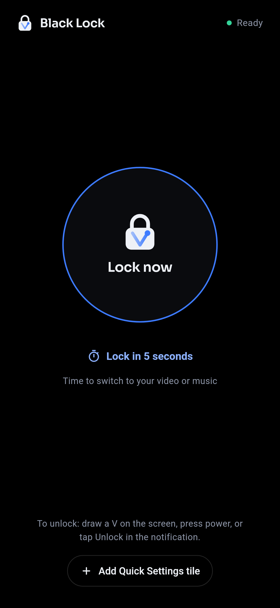
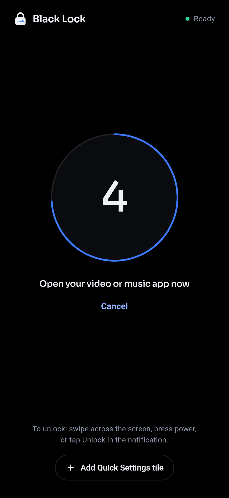
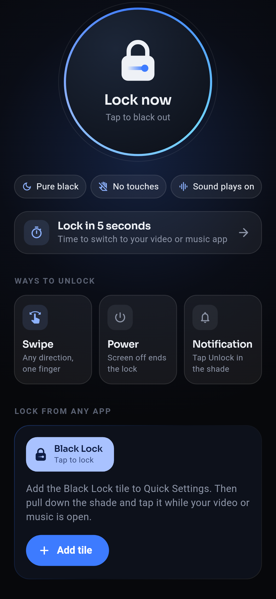
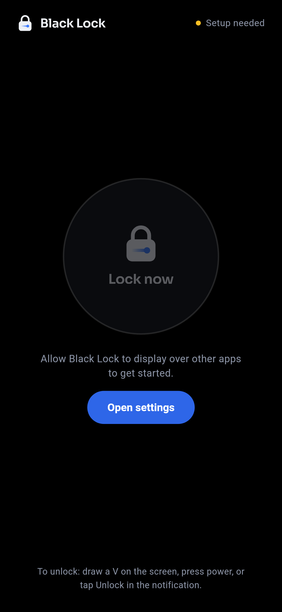

# Black Lock


Android app (Flutter UI + native Kotlin lock) that turns the screen pure black and ignores
touches, while whatever is underneath (video, music, navigation) keeps running.
Swipe across the screen with one finger, in any direction, to unlock.

## Screenshots

<table>
  <tr>
    <td align="center"></td>
    <td align="center"></td>
    <td align="center"></td>
    <td align="center"></td>
  </tr>
  <tr>
    <td align="center">Ready to lock</td>
    <td align="center">5 s countdown</td>
    <td align="center">Unlock ways &amp; tile</td>
    <td align="center">One-time setup</td>
  </tr>
</table>

## Usage: black out while a video plays (e.g. YouTube)

First time only: open Black Lock and tap **Open settings** to turn on "Display over other apps".

**Option 1 — Quick Settings tile (easiest)**

1. In Black Lock, under **Lock from any app**, tap **Add tile** (or drag the "Black Lock" tile into Quick Settings yourself).
2. Start your video in YouTube.
3. Pull down the notification shade and tap the **Black Lock** tile. The shade closes and the screen goes black over the video.

**Option 2 — 5-second countdown**

1. Open Black Lock and tap **Lock in 5 seconds**.
2. Within 5 seconds, switch to YouTube (Recents button or swipe between apps).
3. When the countdown ends, the screen goes black over YouTube. The countdown runs in a background service, so it keeps going after you leave Black Lock.

> Don't use the big **Lock now** button for this: it locks immediately with Black Lock itself on screen, so YouTube would be in the background, where it usually pauses.

**While locked:** the video and sound keep playing, touches are ignored, the screen stays on, and the volume buttons still work.

**To unlock:**

- **Swipe** across the screen with one finger, in any direction.
- Tap **Unlock** on the Black Lock notification, or tap the tile again.
- Press **Power**. This turns the screen off and ends the lock, and YouTube will usually pause because the screen is off.

## How it works

| Part | File |
| --- | --- |
| Flutter screen (setup card, lock orb, 5 s countdown with Cancel, unlock ways, tile card) | `lib/main.dart` |
| Lock orb (breathing glow, countdown ring) and the logo glyph drawn as vectors | `lib/lock_orb.dart` |
| Colours, Sora heading font, glass cards | `lib/theme.dart`, `assets/fonts/` (SIL OFL) |
| Method channel `black_lock` | `android/app/src/main/kotlin/com/blacklock/black_lock/MainActivity.kt` |
| Black cover (overlay window) held by a foreground service | `LockService.kt`, `BlackOverlayView.kt` |
| Unlock-swipe rule (one finger, ≥ max(120dp, 30% of short side), ≤ 1 s, fairly straight) | `SwipeDetector.kt` |
| Quick Settings tile (+ invisible starter activity) | `LockTileService.kt`, `StartLockActivity.kt` |

Other ways out: power button (screen off ends the lock), the notification's Unlock button,
or tapping the tile again. Touches in the first 0.6 s after locking are ignored.

Limits: Home and the notification shade can't be blocked by a normal app; Back is swallowed.

## Build and test

```bash
export PATH="$HOME/development/flutter/bin:$PATH" JAVA_HOME=$HOME/.jdks/jdk-17 ANDROID_HOME=$HOME/Android/Sdk
flutter test                                    # Flutter screen
(cd android && ./gradlew :app:testDebugUnitTest) # swipe rule
flutter build apk --release --split-per-abi      # build/app/outputs/flutter-apk/
FLUTTER_ROOT=$HOME/development/flutter flutter test tool/screenshots_test.dart --update-goldens  # real screenshots → tool/screenshots/
```

## Logo

A padlock with a blue swipe trail ending in a fingertip ("slide to unlock"). Source: `docs/logo.svg` (512 px PNG beside it).
On Android: `res/drawable/ic_launcher_{background,foreground,monochrome}.xml` (adaptive + Android 13 themed icon)
and `ic_lock.xml` (status bar, notification, tile). Brand blue `#3D7BFF` also seeds the Flutter theme.
